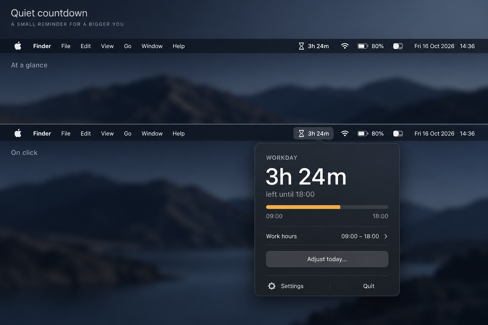

# Dayleft

A small native macOS menu bar app that reminds you how much of your chosen workday is left.

**Status: MVP candidate, pending human verification.** The menu bar shows a live countdown for
your workday. Settings edits recurring hours on a 24-hour dial (overnight shifts included),
workdays, and opt-in launch at login; "Adjust today…" changes or skips only today's shift.
The [manual timer guide](testing/MANUAL%20TO-DO/timer.md) must pass before calling it user-ready.



The MVP is a standalone, local timer. Optional Slopometer goal pacing and task-list connections
belong after MVP. The timer remains complete and usable without connecting an account.

## Develop

Requirements: macOS 14+, full Xcode 26.6 or newer (selected with `xcode-select` or
`DEVELOPER_DIR`), Python 3, Git, and `make`. `make setup` downloads XcodeGen 2.46.0 into
`.tools/` with a SHA-256 check and builds swift-format 604.0.0 from a commit-verified tag
(a few minutes, once). There are no third-party app dependencies.

```sh
make setup
make check
make open
```

In Xcode, select the **Dayleft** scheme and **My Mac**, then Run. The app appears in the menu
bar without a Dock icon. Choose **Quit** in its panel to stop it. For a local development run,
select **Sign to Run Locally** if Xcode requests signing configuration; no development team
or provider credentials are stored in this project.

To try the app without Xcode, run `make app`: it builds a Release copy signed ad hoc for this
Mac at `.build/xcode-local/Build/Products/Release/Dayleft.app`. Open it from Finder. It is not
notarized and must not be distributed.

The panel footer shows the running build as `version+commit` (for example `0.2.0+abc1234`);
see [versioning](docs/development.md#versioning).

`make build` creates an unsigned validation artifact at
`.build/xcode/Build/Products/Debug/Dayleft.app`. It verifies compilation; it is not a signed,
notarized release. `Dayleft.xcodeproj` is generated and ignored; edit `project.yml` instead.

## Project

- [Product specification](SPEC.md) and [scope](SCOPE.md): intended behavior and MVP boundaries.
- [Roadmap](ROADMAP.md): foundation, standalone MVP, then optional connections.
- [Foundation plan](docs/plans/foundation.md): agreed decisions and PR sequence to the MVP.
- [Development guide and command registry](docs/development.md).
- [Documentation index](docs/README.md) and [current timing contract](docs/logic/timing.md).
- [Manual verification](testing/MANUAL%20TO-DO/README.md): pending human checks.
- [Contributing](CONTRIBUTING.md) and [agent operating contract](AGENTS.md).

Swift 6 provides the shared timing core and Swift Testing covers its boundaries. SwiftUI
`MenuBarExtra` provides the native menu bar surface. CI runs structural checks, formatting lint,
core tests, and an unsigned Debug build on macOS 26 with Xcode 26.6.

The name Dayleft is a working project name; name and trademark availability have not been assessed.
Licensed under the [MIT License](LICENSE).
